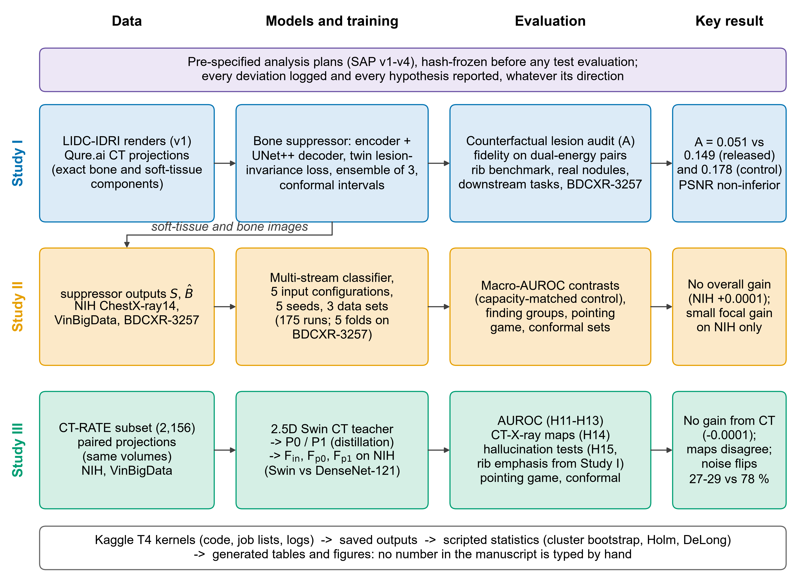

# Explainable and hallucination-aware cross-modality learning from chest CT for chest X-ray analysis

**Lesion-faithful CT-supervised bone suppression, a counterfactual lesion audit and CT-to-X-ray knowledge transfer**

[](https://github.com/HTanvir0011/Thesis-full-project/actions/workflows/tests.yml)
[](LICENSE)
[](release/MODEL_CARD.md)
[](https://github.com/HTanvir0011/Thesis-full-project/releases/tag/v1.0.0)

Code, analysis plans, results, trained bone suppressor, manuscripts and thesis of Tanvir Hossin (Daffodil International University, Dhaka,
Bangladesh). Research code; not a medical device. The manuscripts have not yet been peer reviewed.

## Papers

| Document | Studies | Files |
|---|---|---|
| **Journal paper** (IEEE two-column): *Lesion-Faithful Bone Suppression from Chest CT Projections: Counterfactual Auditing and Gains for Focal Lesion Detection and Classification in Chest Radiographs* | I, II | [PDF](manuscripts/paper_focused_ieee.pdf) · [supplement](manuscripts/paper_focused_ieee_supplementary.pdf) · [LaTeX](submission_tmi/) |
| **Combined manuscript**: *Explainable and hallucination-aware cross-modality learning from chest CT for X-ray disease classification: lesion-faithful bone suppression and Swin transformer knowledge transfer* | I, II, III | Elsevier [PDF](manuscripts/manuscript_elsevier.pdf) · [supplement](manuscripts/manuscript_elsevier_supplementary.pdf) · [LaTeX](submission/); IEEE [PDF](manuscripts/manuscript_ieee.pdf) · [LaTeX](submission_ieee/) |
| **Thesis** | I, II, III | [PDF](manuscripts/thesis.pdf) · [LaTeX](thesis/) |

## Studies and main results

| Study | Question | Main result |
|---|---|---|
| I | Can CT-supervised bone suppression keep pulmonary lesions, and do the suppressed images help detection and classification? | A twin lesion-invariance regulariser cut lesion absorption on VinDr-RibCXR to 0.051, against 0.149 for a released CT-supervised model and 0.178 for a matched control, at non-inferior bone-region PSNR. Added as extra channels, the suppressed images raised Node21 nodule detection (CPM +0.028, 95 % CI 0.009 to 0.047) and NIH ChestX-ray14 macro-AUROC (+0.006). |
| II | Do multi-stream classifiers gain from suppressed inputs, against a control of the same capacity? | No overall gain (NIH +0.0001, 95 % CI -0.0022 to 0.0024); focal findings gained (NIH soft-tissue input +0.0089, Holm p = 0.0024), and soft-tissue Grad-CAM++ maps located focal lesions better than radiograph maps (interaction +0.145, p = 0.0002). |
| III | Does a 2.5D Swin CT teacher (CT-RATE) improve Swin X-ray classifiers through distillation on paired projections? | No gain on NIH (-0.0001, 95 % CI -0.0016 to 0.0014), and CT and X-ray Grad-CAM++ maps disagreed. |

Intervals are 95 % cluster-bootstrap intervals; the manuscripts report every hypothesis, including those that failed.



## Repository structure

```
.
├── manuscripts/      compiled PDFs: journal paper and supplement, combined manuscript (Elsevier, IEEE), thesis
├── submission_tmi/   journal paper (IEEE, Studies I-II) as an Overleaf project
├── submission/       combined manuscript (Elsevier) as an Overleaf project
├── submission_ieee/  combined manuscript (IEEE) as an Overleaf project
├── thesis/           thesis sources (LaTeX)
├── paper/            generated tables and figures shared by the manuscripts and the thesis
├── s4/               research package: CT physics and rendering, bone suppressor, lesion audit, classifiers, cross-modal models, statistics
├── tools/            statistics, tables, figures, packaging of the manuscripts and of this repository
├── tests/            unit tests (CPU, synthetic data)
├── protocol/         analysis plans, their freeze files, decision and deviation logs
├── kernels/, ops/    the Kaggle kernels that were run, and their launchers
├── outputs/          text outputs of the kernels: result files, run summaries, training logs
├── results/          aggregate results and statistics behind every table and figure
├── release/          model card of the released bone suppressor
├── site/             demonstration app (not hosted)
└── splits/           LIDC-IDRI patient split
```

## Installation and tests

```bash
git clone https://github.com/HTanvir0011/Thesis-full-project.git
cd Thesis-full-project
pip install -r requirements.txt     # Python 3.14
python -m pytest                    # CPU with synthetic data; GPU-only tests skip without CUDA
python tools/verify_freeze.py       # every analysis plan is byte-identical to its frozen version
```

## Pretrained bone suppressor

Release [v1.0.0](https://github.com/HTanvir0011/Thesis-full-project/releases/tag/v1.0.0) holds the three checkpoints of the final K = 3
ensemble (ConvNeXt-V2-T encoder, UNet++/CBAM decoder, twin weight 16; 61.5 MB each) with their SHA-256 checksums, which equal the hashes
recorded before the evaluation in `protocol/freeze_v2.json`. They are licensed CC BY-NC-SA 4.0, the licence of the training projections.
[release/MODEL_CARD.md](release/MODEL_CARD.md) describes the model, its intended use and limitations, and gives the code to download, verify
and run it.

## Reproducing the results

Every number in the manuscripts comes from a saved statistics file in `results/`, which the generated tables in `paper/tables/` print.

| Study | Statistics and tables | Figures |
|---|---|---|
| I | `python tools/final_stats.py`; `python tools/bdcxr_stats.py` (external validation); `python tools/szch_site_cal.py` and `python tools/site_cal_tables.py` (site calibration) | `python tools/paper_extras.py --audit-map`, `python tools/fig_pareto.py final`, `python tools/fig_real_qualitative.py`, `python tools/fig_site_cal.py` |
| II | `python tools/hybrid_stats.py` | `python tools/generate_all_thesis_figures.py` |
| III | `python tools/xm_stats.py`, then `python tools/xm_tables.py` | `python tools/fig_v4.py` |
| All | `python tools/tmi_tables.py` (condensed tables of the journal paper) | `python tools/fig_framework.py`, `python tools/fig_tmi.py`, `python tools/fig_data.py` (overviews and data figures) |

The statistics scripts read per-image predictions, labels and, for some figures, images and weights, which are not in this repository (see
Data); without them they stop or overwrite saved files, and `git checkout -- results paper` restores those. The manuscripts compile from
`submission_tmi/`, `submission/` and `submission_ieee/` (pdfLaTeX), or as Overleaf zips from `python tools/pack_overleaf.py --proj
submission_tmi`, `python tools/pack_overleaf.py` and `python tools/pack_overleaf.py --ieee`. Training and evaluation ran in Kaggle kernels:
`kernels/` keeps every version that was run, `ops/launch_*.py` writes and pushes a kernel (it needs your own Kaggle accounts in `config.yaml`
and a token file), and `tools/final_local.sh` runs the locked-set evaluations.

## Data

No image of any data set is redistributed. Obtain each set from its provider under its own terms; the manuscripts cite each one.

| Data set | Role | Licence or access |
|---|---|---|
| LIDC-IDRI (TCIA) | first-generation renders, lesion library, synthetic test CTs | CC BY 3.0 |
| Qure.ai ct2xr-projections | training data of the bone suppressor; Study III projection models | CC BY-NC-SA 4.0 |
| CT-RATE | source of the projections; Study III CT teacher | CC BY-NC-SA 4.0, gated |
| SZCH-X-Rays | paired dual-energy evaluation | CC BY-NC 4.0 |
| VinDr-RibCXR | lesion audit, rib benchmark | licensed; metrics only |
| JSRT | lesion audit, nodule contrast | free after registration; no redistribution |
| Node21 | nodule contrast, detection | CC BY-NC-ND 4.0 |
| TBX11K | detection | CC BY 4.0 |
| VinBigData / VinDr-CXR | detection, classification | competition rules: non-commercial research use |
| NIH ChestX-ray14 | classification | unrestricted use with attribution |
| BDCXR-3257 | external validation | CC BY 4.0; used under the providers' data use agreement (ethical approval REC-FSIT-2025/No: 11928) |

For VinDr-RibCXR, VinBigData, BDCXR-3257, JSRT, Node21 and anything derived from CT-RATE, only aggregate results are kept: no image,
annotation, per-image or per-site file. [EXCLUDED.md](EXCLUDED.md) counts every file left out of this repository and why.

## Analysis plans

The hypotheses, margins, test sets and tests of each study were written down before the data they govern were evaluated. `protocol/` holds the
plans, their freeze files and the decision and deviation logs; `python tools/verify_freeze.py` checks that every plan is unchanged.

## Citation

Please cite the repository (GitHub reads [CITATION.cff](CITATION.cff)); the references of the papers are added here on publication.

```bibtex
@software{hossin2026thesisproject,
  author  = {Hossin, Tanvir},
  title   = {Explainable and hallucination-aware cross-modality learning from chest {CT} for chest {X}-ray analysis:
             code, analysis plans, results and trained bone suppressor},
  year    = {2026},
  version = {1.0.0},
  url     = {https://github.com/HTanvir0011/Thesis-full-project}
}
```

## Licence

- **Code** (`s4/`, `tools/`, `ops/`, `kernels/`, `tests/`, `site/`): [MIT](LICENSE).
- **Bone-suppressor weights** (release v1.0.0): CC BY-NC-SA 4.0, see the [model card](release/MODEL_CARD.md).
- **Manuscripts, thesis, figures and text** (`manuscripts/`, `submission*/`, `thesis/`, `paper/`): © 2026 Tanvir Hossin, all rights reserved
  until publication.
- **Data and results derived from them** keep their providers' terms.

## Acknowledgements

We thank the providers of the data used here: Qure.ai, the CT-RATE team, The Cancer Imaging Archive and the LIDC-IDRI investigators, the
authors of SZCH-X-Rays, VinDr, JSRT, Node21, TBX11K and NIH ChestX-ray14, and Dr. M R Khan Shishu Hospital & Institute of Child Health, Dhaka,
for BDCXR-3257.
